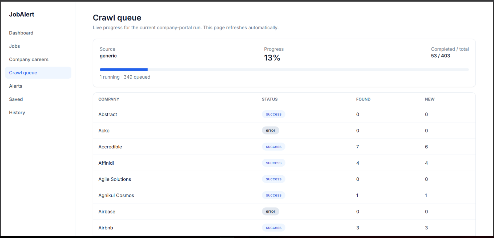
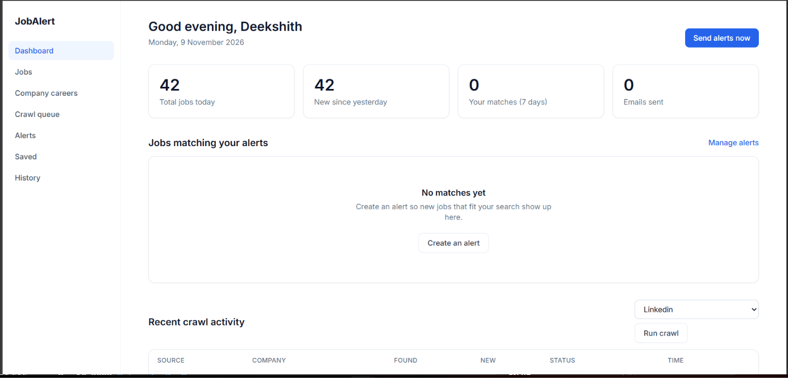

# Job Portal and Company Career Crawler

Personal job-alert portal with a Next.js frontend, Neon PostgreSQL database,
Upstash Redis, and a Python FastAPI/Celery crawler. The crawler supports ATS
providers and a dedicated generic company-career URL list.

The detailed component documentation is maintained in:

- [Frontend README](frontend/README.md)
- [Backend README](backend/README.md)





## Features

- Crawl configured LinkedIn, Workday, Greenhouse, Lever, Ashby, and Naukri sources.
- Crawl only the company URLs in `backend/companies/company_urls.yaml`.
- Dedicated `generic` Celery queue for company career portals.
- Normalize, deduplicate, filter, and publish jobs to Neon through the frontend API.
- Keep fresher and junior roles using `backend/profile.yaml`.
- Live crawl queue and per-company progress at `/queue`.
- Company-career results at `/company-careers`.
- Scheduled daily, three-day, Sunday, and cleanup jobs.
- Delete expired job, crawl-log, and alert data according to the configured retention policy.

## System architecture

```text
                         ┌──────────────────────────────┐
                         │        Next.js portal         │
                         │ pages, filters, queue, alerts │
                         └───────────────┬──────────────┘
                                         │
                         API routes: jobs, logs, queue, alerts
                                         │
                         ┌───────────────▼──────────────┐
                         │       Neon PostgreSQL         │
                         │ jobs, statuses, crawl logs,   │
                         │ rules, alert history          │
                         └──────────────────────────────┘
                                         ▲
                                         │ authenticated HTTP
                                         │
┌──────────────────────┐     ┌───────────┴──────────────┐
│ FastAPI + scheduler  │────>│       Celery + Redis      │
│ trigger endpoints and │     │ broker, retries, queues   │
│ daily/3-day/Sunday   │     └───────────┬──────────────┘
└──────────────────────┘                 │
                         ┌───────────────┴────────────────┐
                         │                                │
              ┌──────────▼──────────┐          ┌──────────▼──────────┐
              │ ATS worker          │          │ Generic worker       │
              │ crawl,default       │          │ generic only         │
              │ Workday, Greenhouse │          │ company_urls.yaml    │
              │ Lever, Ashby, etc.  │          │ custom career pages  │
              └──────────┬──────────┘          └──────────┬──────────┘
                         │                                │
                         └───────────────┬────────────────┘
                                         ▼
                         crawl → deduplicate → normalize
                         → profile/keyword filter → publish
```

### Component responsibilities

| Component | Responsibility |
|---|---|
| `frontend/` | Next.js UI, API routes, Neon queries, alerts, queue display |
| `backend/main.py` | FastAPI health and crawl-trigger endpoints |
| `backend/tasks/scheduler.py` | Scheduled crawl and cleanup dispatch |
| `backend/tasks/crawl_tasks.py` | One Celery task per company and pipeline orchestration |
| `backend/celery_app.py` | Redis broker/backend, task routes, queue definitions |
| `backend/crawlers/` | Provider adapters and generic Playwright crawler |
| `backend/pipeline/` | Deduplication, normalization, filtering, and publishing |
| `backend/companies/companies.yaml` | ATS-specific company configurations |
| `backend/companies/company_urls.yaml` | Generic company career URLs only |
| `backend/profile.yaml` | Matching keywords, titles, locations, and experience rules |

## Data flow and storage rules

1. A manual endpoint or scheduler creates a crawl run.
2. Celery dispatches one `crawl_company` task per configured company.
3. The crawler extracts raw jobs from the provider or career page.
4. Redis deduplication removes jobs already seen within the retention window.
5. Normalization derives experience level, job type, work mode, dates, and tags.
6. The profile filter keeps only eligible fresher/junior roles and configured
   keywords while excluding senior or unrelated roles.
7. The publisher sends batches to `POST /api/jobs`.
8. The Next.js API validates and inserts jobs into Neon, returning inserted and
   duplicate counts.
9. Crawl status is sent to `POST /api/crawl/log` for the dashboard and queue.

The crawler does not store every page or every extracted link. A job is stored
only after it passes deduplication, normalization, profile filtering, and
successful publishing. `no_jobs_found`, `all_filtered_by_profile`, and
`all_duplicates` are successful crawl outcomes with zero new database inserts.

## Queue boundaries

The company portal path is intentionally isolated:

- `generic` queue: only URLs from `backend/companies/company_urls.yaml`
- `crawl` and `default` queues: ATS/provider crawls and orchestration
- `crawler-generic-worker`: consumes only `generic`
- `crawler-worker`: consumes `crawl,default`

Therefore Greenhouse, Workday, LinkedIn, Lever, Ashby, or Naukri retries cannot
occupy the dedicated company-portal worker.

## Project layout

```text
backend/
  companies/company_urls.yaml  # Generic company career URLs
  companies/companies.yaml     # ATS provider configurations
  crawlers/                    # Provider and generic crawlers
  tasks/                       # Celery tasks and scheduler
  pipeline/                    # Deduplication, normalization, filtering, publishing
frontend/
  app/                         # Next.js pages and API routes
  components/                  # Portal and queue UI
Images/                        # README screenshots
```

## Local setup

Follow the complete frontend setup, environment-variable reference, crawler
contract, and email-worker instructions in [frontend/README.md](frontend/README.md).

### Frontend

```powershell
cd frontend
npm install
Copy-Item .env.local.example .env
# Fill in Neon, Upstash, and crawler variables.
npm run db:setup
npm run dev
```

### Backend API

Follow the complete crawler architecture, Windows commands, scheduler behavior,
Docker deployment, and company-portal queue instructions in
[backend/README.md](backend/README.md).

```powershell
cd backend
python -m venv .venv
.\.venv\Scripts\Activate.ps1
pip install -r requirements.txt
python -m playwright install chromium
Copy-Item .env.example .env
# Set PORTAL_API_URL, PORTAL_API_KEY, SERVICE_API_KEY, and REDIS_URL.
python -m uvicorn main:app --host 127.0.0.1 --port 8000
```

### Dedicated company-portal worker

Run this in a separate terminal:

```powershell
cd backend
.\.venv\Scripts\Activate.ps1
python -m celery -A celery_app worker --loglevel=info -Q generic --pool=solo --concurrency=1
```

Trigger only the URLs in `company_urls.yaml`:

```powershell
cd backend
.\.venv\Scripts\python.exe -c "from tasks.crawl_tasks import trigger_company_url_crawls; print(trigger_company_url_crawls.delay().id)"
```

The dedicated endpoint is:

```text
POST /crawl/company-urls
```

The general ATS worker uses `-Q crawl,default` and should not be used when
you want company portals only.

## Docker deployment

Run the crawler API and workers on a persistent Linux host. Do not run Celery,
Playwright, or the long-running scheduler inside Vercel functions.

```bash
cd backend
cp .env.example .env
# Set production values in .env.
docker compose up -d --build
docker compose ps
docker compose logs -f crawler-generic-worker
```

Deploy the frontend to Vercel with:

```env
DATABASE_URL=your_neon_connection_string
REDIS_URL=your_upstash_rediss_url
NEXT_PUBLIC_APP_URL=https://your-frontend-domain
CRAWLER_API_KEY=shared_secret
CRAWLER_SERVICE_URL=https://your-crawler-domain
```

Backend values must include:

```env
REDIS_URL=your_upstash_rediss_url
PORTAL_API_URL=https://your-frontend-domain
PORTAL_API_KEY=shared_secret
SERVICE_API_KEY=your_service_api_key
```

`PORTAL_API_KEY` must equal the frontend `CRAWLER_API_KEY`. Never commit
`.env` files or credentials.

## Schedule

The backend scheduler uses `Asia/Kolkata`:

- Monday-Saturday at 06:00: configured ATS, LinkedIn, and generic sources
- Every three days: all generic company URLs
- Sunday at 06:00: full ATS and generic crawl
- Daily at 05:30: remove data older than the retention period

Inngest is for frontend alert-email scheduling only. It is not required for
crawling, Celery, Redis task delivery, or Neon job ingestion.

## Run company portals only

Start the API and dedicated worker, then trigger only the YAML URLs:

```powershell
cd backend
.\.venv\Scripts\python.exe -m uvicorn main:app --host 127.0.0.1 --port 8000
```

```powershell
cd backend
.\.venv\Scripts\python.exe -m celery -A celery_app worker --loglevel=info -Q generic --pool=solo --concurrency=1
```

```powershell
cd backend
.\.venv\Scripts\python.exe -c "from tasks.crawl_tasks import trigger_company_url_crawls; print(trigger_company_url_crawls.delay().id)"
```

Monitor the queue at `http://localhost:3000/queue`. Logs should show
`source=generic` and URLs from `company_urls.yaml`; they should not show
`source=greenhouse`, `source=workday`, or another ATS source.

## Verification

```bash
curl https://your-crawler-domain/health
```

Expected response:

```json
{"status":"ok","version":"1.0.0"}
```

Open the frontend queue page and confirm that entries show
`source=generic` with URLs from `company_urls.yaml`.

## Testing

```powershell
cd backend
.\.venv\Scripts\python.exe -m compileall -q .

cd ..\frontend
npm run typecheck
```

## Notes

- Generic pages may return no jobs when a site is protected, dynamic, expired,
  or does not expose job links.
- Crawled jobs are stored only after deduplication, normalization, profile
  filtering, and successful publishing to the frontend API.
- Inngest is used for frontend alert scheduling; it is not required for the
  Celery crawler or Neon ingestion.
